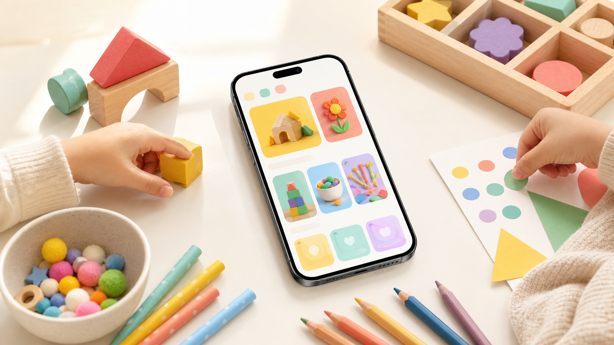
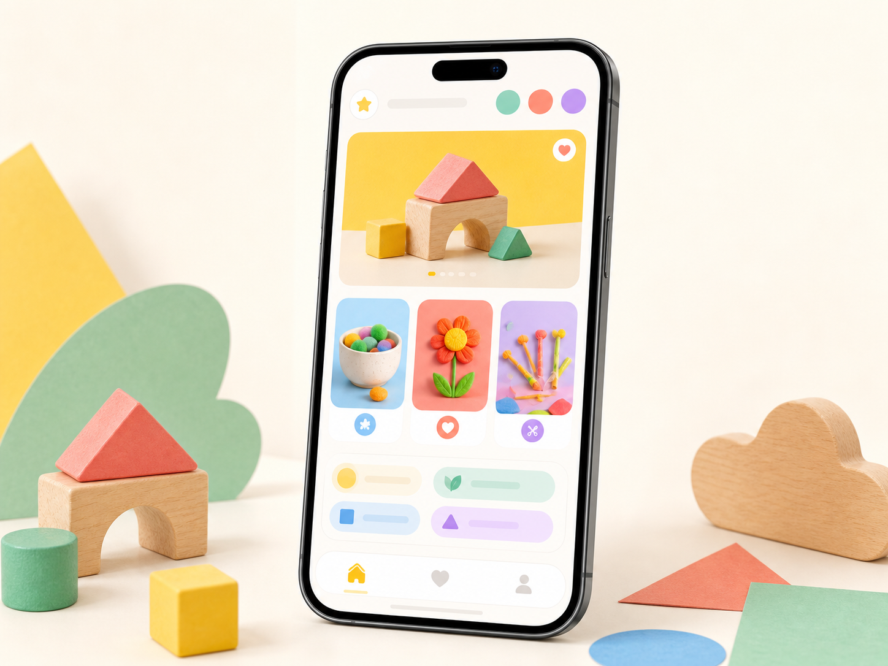
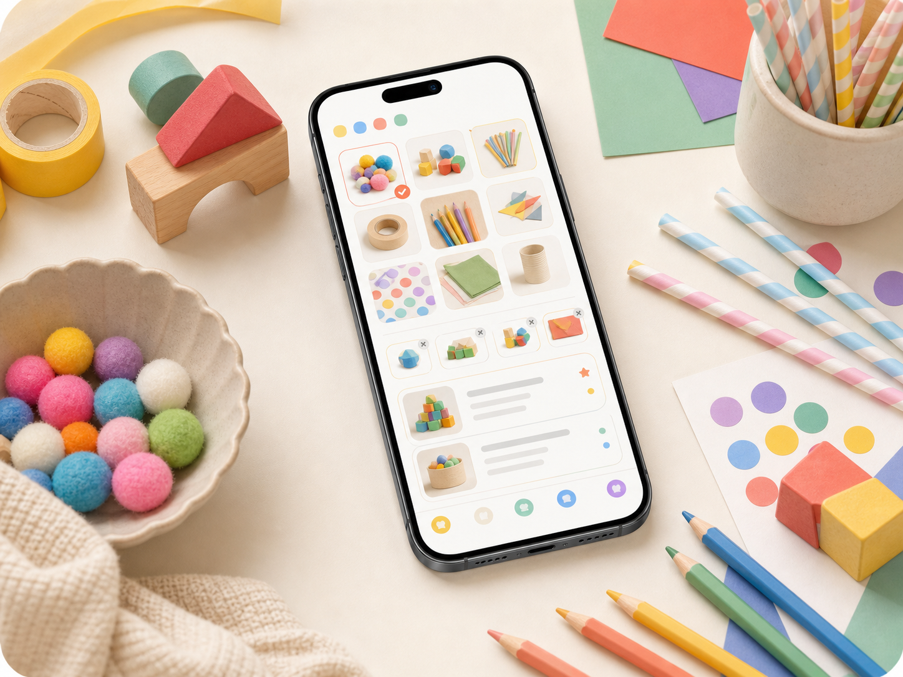
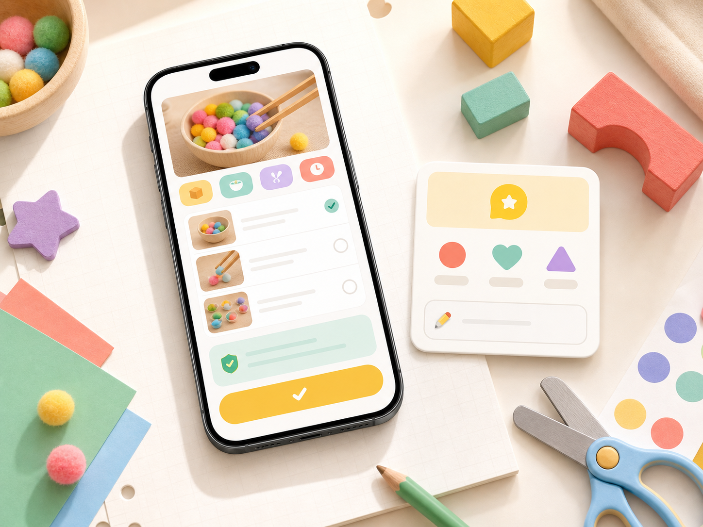

<div align="center">
  

  <h1>놀이 레시피</h1>
  <p><strong>집에 있는 재료로 오늘 할 놀이를 고르는 육아 놀이 추천 앱</strong></p>

  <p>
    0-48개월 · 191개 놀이 · 48개 표준 재료 · 로컬 퍼스트
  </p>
</div>

## 한 줄 소개

**놀이 레시피**는 아이의 월령, 집에 있는 재료, 최근 놀이 기록을 바탕으로 보호자가 오늘 바로 시작할 수 있는 놀이를 추천하는 모바일 앱입니다. 단순한 놀이 목록이 아니라, 실제 가정에서 가능한 준비물과 아이의 발달 단계까지 함께 고려합니다.

## 왜 필요한가요

아이와 놀아주는 일은 중요하지만, 매번 좋은 놀이를 떠올리는 일은 쉽지 않습니다. 보호자는 보통 이런 질문 앞에서 멈춥니다.

- 지금 아이 월령에 맞는 놀이일까?
- 집에 있는 재료만으로 바로 할 수 있을까?
- 준비가 너무 번거롭지는 않을까?
- 오늘은 어떤 발달 영역을 자극해주면 좋을까?
- 전에 했던 놀이와 너무 비슷하지는 않을까?

놀이 레시피는 이 판단 과정을 앱이 대신 정리해줍니다. 보호자는 놀이를 검색하고 비교하는 시간보다, 아이와 실제로 노는 시간에 더 집중할 수 있습니다.

## 앱의 핵심 가치

| 가치 | 설명 |
| --- | --- |
| 상황 맞춤 추천 | 아이 월령, 장소, 보유 재료, 최근 기록을 바탕으로 추천합니다. |
| 준비물 현실성 | 종이, 스티커, 빨대, 블록, 그릇처럼 집에서 찾기 쉬운 재료를 기준으로 탐색합니다. |
| 발달 균형 | 소근육, 대근육, 인지, 언어, 정서, 사회성, 감각 영역을 함께 고려합니다. |
| 빠른 실행 | 놀이 시간, 준비 시간, 난이도를 미리 보여줘 바로 시작할 수 있게 합니다. |
| 안전한 진행 | 놀이 단계와 함께 안전 유의사항을 제공해 보호자가 놓치기 쉬운 부분을 확인합니다. |
| 반복 관리 | 완료 기록과 즐겨찾기를 통해 했던 놀이와 다시 하고 싶은 놀이를 관리합니다. |

## 주요 화면 미리보기

| 오늘의 놀이 추천 | 재료 기반 탐색 | 놀이 상세와 기록 |
| --- | --- | --- |
|  |  |  |
| 아이 월령과 최근 기록을 반영해 지금 할 놀이를 먼저 보여줍니다. | 집에 있는 재료를 고르면 가능한 놀이를 빠르게 좁혀줍니다. | 놀이 단계, 안전 유의사항, 완료 기록과 아이 반응을 연결합니다. |

## 주요 경험

### 오늘의 놀이 추천

홈 화면은 보호자에게 지금 가장 필요한 결정을 먼저 보여줍니다. 아이에게 맞고, 집에 있는 재료로 가능하며, 최근에 너무 자주 하지 않은 놀이를 우선 추천합니다.

추천 카드에서는 적정 월령, 발달 영역, 준비물 상태, 완료 여부를 함께 확인할 수 있어 여러 놀이를 오래 비교하지 않아도 됩니다.

### 재료에서 시작하는 탐색

보호자는 놀이명을 몰라도 괜찮습니다. 오늘 집에 있는 재료를 고르면 그 재료로 가능한 놀이를 찾을 수 있습니다.

예를 들어 스티커, 종이, 그릇, 빨대, 블록, 물감처럼 일상적인 재료를 중심으로 놀이가 연결됩니다. 준비물이 부족한 경우에는 어떤 재료가 더 필요한지도 함께 보여줍니다.

### 발달 영역을 고려한 놀이 선택

놀이는 재미뿐 아니라 발달 경험이기도 합니다. 놀이 레시피는 각 놀이에 소근육, 대근육, 인지, 언어, 정서, 사회성, 감각 영역을 연결해 보호자가 오늘의 놀이 의도를 쉽게 이해할 수 있게 합니다.

검색과 기록은 같은 7개 발달 영역을 사용합니다. 검색에서는 각 놀이에 연결된 모든 영역을 표시하며, 미술은 추가 필터의 별도 놀이 유형으로 선택합니다. 기록의 영역을 누르면 아이 월령을 기준으로 해당 영역의 놀이를 찾으며, 이전 검색의 추가 조건은 초기화합니다. 기록에 표시되는 경험 영역 수는 선택 기간에 놀이한 영역 수이며, 전체 영역 수 7개와 함께 보여줍니다.

탐색의 기본 정렬은 ‘새 놀이 우선’입니다. 월령·영역·재료 등의 조건을 먼저 적용한 뒤 NEW 기간에 해당하는 놀이를 맨 위에 표시합니다. NEW끼리는 최근 등록일순으로, 같은 날짜면 재료 충족도와 준비 시간순으로 정렬하며, 일반 놀이는 기존 맞춤 기준을 따릅니다. NEW 기간이 끝나면 우선 표시도 자동으로 종료됩니다. ‘맞춤순·짧은 놀이순·준비 시간순’을 선택하면 해당 기준을 적용하며, 목록 수 제한은 정렬 후에 적용합니다.

### 단계별 놀이 가이드

놀이 상세 화면에서는 준비물, 진행 순서, 안전 유의사항, 교육 효과를 한 흐름으로 제공합니다. 보호자가 긴 설명을 읽지 않아도 놀이를 시작할 수 있도록 단계 중심으로 구성했습니다.

### 기록과 피드백

완료한 놀이는 기록으로 남고, 아이가 어떻게 반응했는지도 함께 저장할 수 있습니다. 집중했는지, 스스로 했는지, 도움이 필요했는지 같은 반응은 이후 추천 품질을 높이는 단서가 됩니다.

## 화면 흐름

```text
아이 정보 입력
  ↓
보유 재료 선택
  ↓
오늘의 추천 놀이 확인
  ↓
놀이 상세에서 준비물과 단계 확인
  ↓
놀이 완료 기록과 아이 반응 저장
  ↓
다음 추천에 최근 기록 반영
```

## 화면별 역할

| 화면 | 역할 |
| --- | --- |
| 온보딩 | 아이 생년월과 집에 있는 재료를 설정합니다. |
| 홈 | 오늘 추천할 놀이와 상황별 탐색 진입점을 보여줍니다. |
| 검색 | 월령, 장소, 재료, 발달 영역 기준으로 놀이를 찾습니다. |
| 놀이 상세 | 준비물, 놀이 단계, 안전 유의사항, 교육 효과를 확인합니다. |
| 피드백 | 놀이 후 아이 반응을 기록합니다. |
| 기록 | 완료한 놀이 이력을 확인합니다. |
| 즐겨찾기 | 다시 해보고 싶은 놀이를 모아둡니다. |
| 마이페이지/설정 | 아이 정보와 앱 사용 조건을 관리합니다. |

## 추천은 이렇게 동작합니다

놀이 레시피의 추천은 단순히 인기순이나 최신순으로 정렬하지 않습니다. 보호자의 현재 상황에 맞는 후보를 먼저 걸러낸 뒤, 여러 기준을 조합해 상위 놀이를 고릅니다.

### 1. 먼저 맞지 않는 놀이를 제외합니다

- 아이 월령 범위에 맞지 않는 놀이
- 현재 장소 조건과 맞지 않는 놀이
- 가능한 시간보다 지나치게 긴 놀이
- 보호자가 제외한 재료가 포함된 놀이
- 공개 상태가 아닌 놀이

### 2. 남은 놀이에 점수를 매깁니다

- 보유 재료와 필수 준비물의 일치도
- 아이에게 필요한 발달 영역과의 관련성
- 놀이 시간의 적절성
- 이전 피드백과 아이 반응
- 최근 완료한 놀이와의 중복 여부

### 3. 결과의 다양성을 조정합니다

점수가 높은 놀이만 고르면 비슷한 발달 영역이나 비슷한 재료의 놀이가 반복될 수 있습니다. 놀이 레시피는 추천 결과가 한쪽으로 치우치지 않도록 상위 후보를 조정합니다.

## 콘텐츠 구성

| 항목 | 내용 |
| --- | --- |
| 대상 월령 | 0-48개월 |
| 놀이 수 | 191개 |
| 재료 체계 | 7개 카테고리, 48개 표준 재료 |
| 발달 영역 | 소근육, 대근육, 인지, 언어, 정서, 사회성, 감각 |
| 장소 | 실내, 실외, 어디서나 |
| 놀이 정보 | 준비물, 진행 단계, 안전 유의사항, 교육 효과, 태그, 출처 |

## 다른 놀이 콘텐츠와 다른 점

### 랜덤 추천이 아닙니다

아이의 나이와 집의 재료 상황을 먼저 보고 추천합니다. 그래서 보기에는 좋아도 당장 하기 어려운 놀이보다, 지금 실제로 가능한 놀이가 먼저 나옵니다.

### 준비 부담을 낮춥니다

놀이를 위해 특별한 교구를 사야 한다는 전제를 줄였습니다. 종이, 그릇, 스티커, 빨대, 블록처럼 이미 집에 있을 가능성이 높은 재료를 중심으로 콘텐츠를 구성했습니다.

### 발달 의도를 보여줍니다

보호자는 놀이를 고르면서 자연스럽게 어떤 발달 영역과 연결되는지 확인할 수 있습니다. 재미와 발달 정보를 분리하지 않고 하나의 선택 과정 안에 둡니다.

### 기록이 다음 추천으로 이어집니다

완료한 놀이와 아이 반응은 단순한 로그로 끝나지 않습니다. 최근에 한 놀이를 피하고, 아이 반응을 추천에 반영하는 방식으로 다음 선택을 더 똑똑하게 만듭니다.

## 디자인 방향

놀이 레시피의 화면은 보호자가 반복해서 쓰는 생활 도구에 가깝게 설계합니다.

- 밝고 따뜻한 색감으로 육아 앱의 부담을 낮춥니다.
- 카드와 배지를 사용해 월령, 재료 상태, 발달 영역을 빠르게 스캔할 수 있게 합니다.
- 긴 설명보다 단계별 행동과 핵심 정보를 먼저 보여줍니다.
- 추천 화면은 탐색보다 선택에 집중하도록 구성합니다.

신규 놀이에는 최초 등록일 `createdAt`부터 달력 기준 한 달 동안 `NEW` 배지가 표시됩니다. 한국 날짜를 기준으로 다음 달 같은 날짜에 자동으로 사라지며, 다음 달에 같은 날짜가 없으면 말일에 만료됩니다. 놀이 수정이나 번들 갱신으로 기간이 연장되지 않고, 생성일이 없는 기존 놀이에는 표시하지 않습니다. 예를 들어 2026-10-09에 등록한 놀이는 2026-11-09 00:00부터 배지가 사라집니다.

## 로컬 퍼스트

놀이 레시피는 서버 의존도를 낮춘 로컬 중심 앱입니다. 놀이 콘텐츠와 사용자 기록은 앱 안에서 빠르게 접근할 수 있도록 구성되어 있으며, 기본 사용 경험은 네트워크 연결보다 기기 내 데이터 흐름을 우선합니다.

## 웹과 PWA 실행

기존 iOS/Android 앱과 같은 추천 엔진·데이터를 사용하는 모바일 웹을 제공합니다. 웹 첫 방문에서는 아이 월령만 선택하면 추천을 볼 수 있고, `/play/play_001` 형태의 놀이 링크는 온보딩 없이 열립니다. 상세 화면에서 링크를 공유하거나 복사할 수 있습니다.

```bash
pnpm install
pnpm build:web
pnpm serve:web
```

로컬 주소는 `http://127.0.0.1:4173`입니다. 포트는 `PORT`, 바인딩 주소는 `HOST` 환경 변수로 바꿀 수 있습니다. 배포 도메인이 정해지면 `PUBLIC_ORIGIN=https://example.com`으로 공유 메타데이터의 기준 주소를 지정할 수 있습니다. 서버는 빌드 결과를 제공하며 계정 서버는 포함하지 않습니다. 웹 사용량 분석은 아래 GA4 설정과 이용자의 별도 참여 선택에 따라 작동합니다.

- 빌드에 필요한 `data/plays.json`, `data/materials.json`, `images/plays/`는 Git 저장소에 포함합니다. Vercel에서도 저장소를 복제한 뒤 같은 파일로 빌드합니다. `public/media/`, `public/icons/`와 `dist/`는 빌드 과정에서 생성하며 Git에 포함하지 않습니다.
- `build:web`은 웹용 WebP 상세 이미지·썸네일·재료 이미지와 설치 아이콘을 생성합니다. 원본 앱 이미지는 변경하지 않습니다. 웹에서는 시스템 한글 폰트를 사용하고, 화면 밖 이미지는 지연 로딩합니다.
- 재료 이미지 주소에는 이미지 내용의 해시를 붙입니다. 빌드가 `src/constants/materialImageVersions.json`을 갱신하므로 기본 아이콘을 새 그림으로 바꾼 뒤에도 이전 이미지 캐시와 구분됩니다.
- 개발 중에는 `pnpm web`을 사용할 수 있습니다. 설치·오프라인·업데이트 검증에는 위의 웹 빌드와 서버 명령을 사용합니다.
- 홈 화면 설치, 버전별 서비스 워커 캐시, 오프라인 앱 셸과 방문한 이미지를 지원합니다. 이미지 캐시는 최대 80개이며, 오래된 이미지는 정리됩니다. 새 버전은 안내의 ‘새 버전 열기’를 눌렀을 때 적용됩니다.
- 홈 화면 설치는 설정의 ‘앱처럼 이용하기’에서 할 수 있습니다. 설치 창을 지원하지 않는 브라우저에서는 같은 위치에서 수동 설치 방법을 안내하고, 설치 후에는 추가 완료 상태를 표시합니다.
- 웹 빌드의 스타일시트 파일명에는 내용 해시를 붙입니다. 이전 서비스 워커가 업데이트 대기 중이어도 새 HTML이 이전 CSS를 불러와 레이아웃이 깨지지 않도록 합니다.
- 서비스 워커와 설치 기능은 HTTPS 또는 localhost에서 동작합니다. 휴대폰에서 LAN의 HTTP 주소로 접속하는 것은 PWA 설치·오프라인 검증을 대신하지 못합니다.
- 설정·즐겨찾기·기록은 브라우저에 저장됩니다. 저장소 삭제, 다른 기기·브라우저 사용, 일부 iOS 홈 화면 앱에서는 기존 기록이 공유되지 않을 수 있습니다. 계정 백업과 기기 간 동기화는 제공하지 않습니다.

검증 명령은 `pnpm typecheck`, `pnpm test`, `pnpm test:web`입니다. 웹 테스트는 직접 링크·새로고침·응답 압축·경로 접근과 오프라인 캐시·업데이트 동작을 검증합니다.

### Vercel 배포

운영 주소는 [https://nori.lestly.io](https://nori.lestly.io)입니다. 배포 흐름은 다음과 같습니다.

| Git 브랜치 | Vercel 환경 | 적용 주소 |
| --- | --- | --- |
| `preview` | Preview | Vercel이 부여한 `*.vercel.app` 주소 |
| `main` | Production | `https://nori.lestly.io` |

변경사항은 `preview`에서 작업하고 푸시해 미리보기에서 확인합니다. 확인한 `preview`를 `main`에 병합하면 운영 환경으로 배포됩니다. Vercel의 Production Branch는 `main`으로, 운영 도메인 `nori.lestly.io`는 Production에 연결합니다.

기존 Vercel 계정에서 **Add New → Project**를 열고 GitHub의 `alstjs1207/nori-recipe` 저장소를 가져옵니다. 로컬 폴더 이름은 `play-recipe`이지만 GitHub 저장소에는 앱이 루트에 있으므로 **Root Directory는 `.`**로 둡니다.

| 설정 | 값 |
| --- | --- |
| Framework Preset | Other |
| Root Directory | `.` |
| Build Command | `pnpm build:web` |
| Output Directory | `dist` |
| Install Command | `npx --yes pnpm@10.33.0 install --frozen-lockfile` |
| Node.js Version | `24.x` |

`vercel.json`에서 프레임워크·설치·빌드·출력 설정을 적용합니다. 설치 명령은 `package.json`의 `packageManager`와 같은 pnpm 버전을 사용합니다. pnpm 버전을 바꿀 때는 두 파일을 함께 갱신합니다. `serve:web`은 로컬 검증 서버이며 Vercel에서는 실행하지 않습니다.

- **System Environment Variables 접근을 활성화**합니다. `PUBLIC_ORIGIN=https://nori.lestly.io`는 **Production에만** 설정합니다. Preview에서는 `PUBLIC_ORIGIN`을 비워 `VERCEL_URL`로 해당 미리보기의 공유 주소를 생성합니다. Production에서 `PUBLIC_ORIGIN`이 없으면 `VERCEL_PROJECT_PRODUCTION_URL`을 사용합니다. 별도 도메인 추가나 환경변수 변경 후에는 재배포합니다.
- `vercel.json`의 경로 설정은 검색·설정·피드백 화면을 새로고침해도 앱을 엽니다. 놀이 상세는 빌드가 생성한 개별 HTML을 제공해 공유 제목·이미지를 유지합니다. 존재하지 않는 이미지·JS·놀이 경로는 앱 셸로 대체하지 않고 404로 처리합니다.
- 서비스 워커와 설치 설정은 재검증할 수 있는 응답 헤더를 사용합니다. 기본 호스팅만 사용하고 Vercel Web Analytics·Speed Insights는 활성화하지 않습니다. GA4는 별도 설정이 없으면 비활성입니다.
- `preview`에 푸시하면 Preview 배포를 확인하고, `preview`를 `main`에 병합하면 Production 배포를 확인합니다.

첫 배포 후 운영 HTTPS 주소에서 `/`, `/search`, `/play/play_001`을 직접 열고 새로고침, 놀이 이미지, 공유 미리보기, 홈 화면 설치를 확인합니다. 공개 배포 전에 아래 ‘고지와 공개 전 확인’의 운영자·문의 연락처 등 미정 항목도 확정합니다.

### 선택적 GA4 웹 분석

로컬 기본값은 비활성입니다. 운영 웹/PWA에만 Google tag를 사용하며 Firebase 패키지나 계정 서버를 추가하지 않습니다. 아래 공개 환경변수는 **빌드 시** 반영되므로 변경 후 다시 빌드합니다. 운영 연락처·Google의 공개 처리 가능 국가·별도 국외 이전 동의·이벤트 보유기간을 개인정보 처리방침과 동의 화면에 반영했습니다.

웹 배포 빌드는 Expo 변환 캐시를 초기화해 이전 환경에서 인라인된 분석 설정이 재사용되지 않도록 합니다. `VERCEL_ENV=preview`인 빌드에서는 동의 안내·선택·거부·중단 UI를 표시하되 GA4 설정을 강제로 비활성화합니다. Preview에 운영 분석 환경변수가 잘못 등록되어도 Google 태그·쿠키·이벤트를 만들지 않습니다. Preview 선택은 별도 로컬 키와 해당 미리보기 origin 범위로 저장하며 운영 사이트의 분석 동의로 사용하지 않습니다.

동의 화면은 ‘서비스 개선에 참여할까요?’와 쉬운 목적 설명을 먼저 표시합니다. 두 선택 항목은 ‘서비스 개선을 위한 이용 통계 분석’, ‘Google의 해외 분석 처리·보관’으로 설명하며, 바로 아래의 상세 펼침 항목에 ‘개인정보 수집·이용’, ‘개인정보 국외 이전’을 명확히 표시합니다. 수집·이전 항목, 국가, 수신자, 기간, 거부 안내와 기본 미선택·두 항목 동의 조건은 유지합니다. Preview의 전송 차단 안내는 ‘미리보기 · 분석 정보 전송 안 함’으로 표시하며, 수집 목적·항목을 변경하지 않으므로 동의 방침 버전은 유지합니다.

모바일 Preview 반복 검증은 마이페이지의 ‘사용량 분석 참여’에서 **동의 안내 다시 테스트**를 누릅니다. 미리보기의 동의 선택과 현재 탭의 안내 표시 상태만 초기화하고 아이 설정·재료·저장·기록은 유지합니다. 이후 상세를 20초 읽거나 본문 절반까지 스크롤하고 돌아오면 브라우저의 뒤로가기로 첫 홈(시작 화면)에 돌아온 경우에도 안내를 표시합니다. 아직 상세를 읽지 않은 첫 진입에는 표시하지 않습니다. ‘새 버전 열기’ 안내가 있으면 최신 버전을 적용한 뒤 확인합니다.

2026-10-13에 생성한 GA4 계정·속성은 **노리 레시피**입니다. 계정 ID는 `411729499`, 속성 ID는 `558651002`, 웹 스트림 **노리 레시피 웹**의 ID는 `16118203116`이며 측정 ID는 `G-KVHS8WW1X5`입니다. [GA4 속성 열기](https://analytics.google.com/analytics/web/#/a411729499p558651002/reports/intelligenthome). 보고 시간대는 대한민국(UTC+09:00), 통화는 KRW입니다.

Vercel **Production에만** 아래 설정으로 수집을 활성화합니다. 이용자가 개인정보 수집·이용과 Google 국외 이전을 각각 선택하고 동의 버튼을 눌러야 실제 수집이 시작됩니다. 로컬 예제 설정은 같은 측정 ID와 비활성 기본값을 사용하며 Preview에는 분석 환경변수를 등록하지 않습니다.

```bash
EXPO_PUBLIC_GA_ENABLED=true
EXPO_PUBLIC_GA_MEASUREMENT_ID=G-KVHS8WW1X5
EXPO_PUBLIC_ANALYTICS_ORIGIN=https://nori.lestly.io
```

- 도메인은 HTTPS의 정확한 origin으로 지정합니다. 설정한 origin 외의 localhost·미리보기·다른 서브도메인에서는 태그를 로드하지 않습니다. 운영·로컬 빌드에서 `GA_ENABLED`가 꺼져 있거나 설정이 없으면 분석 안내도 표시하지 않습니다. Preview는 빌드가 자동으로 지정하는 `EXPO_PUBLIC_ANALYTICS_PREVIEW=true`로 안내를 표시하며 수집은 항상 차단합니다. 운영 활성화 값이 잘못되면 웹 빌드가 실패합니다.
- GA4 웹 스트림의 **향상된 측정을 전체 끕니다**. 페이지뷰는 Expo Router의 실제 화면 전환에서 직접 전송하며 `send_page_view: false`를 사용합니다. 자동 히스토리 페이지뷰·검색·폼·클릭 측정을 함께 켜지 않습니다. Google Signals, 광고 맞춤설정과 Ads 연결도 사용하지 않는 구성을 기준으로 합니다.
- 생성한 계정의 데이터 공유 옵션 4개를 모두 껐고 Google Signals·사용자 제공 데이터 수집을 활성화하지 않습니다. 속성의 광고 개인 최적화는 지역 컨트롤에서 **307개 지역 모두 차단**으로 설정합니다. 지역 컨트롤은 광고 사용 범위를 정하는 설정이며 Google 서버의 처리 국가를 지정하는 기능은 아닙니다.
- Basic Consent Mode로 분석 동의 전에는 Google 태그 자체를 로드하지 않습니다. 설정에서 참여를 중단하면 이후 앱 이벤트를 차단하고 로드 대기 중인 이벤트와 서비스 분석 쿠키를 폐기합니다. 같은 운영 origin·측정 ID·동의 방침 버전의 선택만 복원합니다. 수집 목적·항목이 바뀌면 `ANALYTICS_CONSENT_VERSION`도 갱신합니다.
- 2026-10-15 동의 방침은 버전 **3**입니다. 놀이별 별점·선택형 반응과 기존 기록의 소급 수집을 추가했으므로 기존 버전 동의도 다시 받습니다. 수집·이용 및 국외 이전 체크박스는 모두 기본 미선택이며, 둘 다 선택해야 동의 버튼이 활성화됩니다. 이전 버전의 선택은 복원하지 않습니다. 국외 이전은 [개인정보 보호법 제28조의8제1항제1호](https://www.law.go.kr/LSW/lsLinkCommonInfo.do?chrClsCd=010202&lsJoLnkSeq=1029332507)의 별도 동의를 근거로 구성합니다.
- 첫 홈 방문·월령 설정·놀이 상세·기록 작성 중에는 분석 참여를 자동으로 요청하지 않습니다. 공개 놀이 상세를 보이는 탭에서 **20초** 읽거나 본문 절반까지 스크롤한 뒤 홈·탐색·저장 목록으로 돌아오면 동의 창을 바로 한 번 표시합니다. 중간 안내 카드나 추가 진입 버튼 없이 한 화면에서 고지를 확인하고 참여 여부를 선택하며, 동의 창 닫기는 동의로 처리하지 않습니다. 현재 탭의 `sessionStorage`에는 안내를 표시했다는 값만 저장해 새로고침에도 반복 노출하지 않습니다. 명시적으로 거부한 이용자에게는 자동 안내를 다시 표시하지 않으며 설정에서 직접 참여할 수 있습니다.
- 안내 시점 판단은 기기 내 메모리에서만 처리하며 상세 열람 이력·시간·스크롤 이벤트를 저장하거나 GA4에 보내지 않습니다. 동의 전에 일어난 조회·클릭을 나중에 소급 전송하지 않습니다. 단, 버전 3 동의는 현재 기기에 남아 있는 놀이 기록의 별점·선택형 반응 소급 수집을 포함합니다. 지표는 동의 후 이용 패턴으로 해석하며 전체 방문자의 첫 조회·전환율을 의미하지 않습니다. 안내 노출 조건은 기존과 같고, 이번 수집 항목 변경에는 방침 버전 3을 적용합니다.
- 분석 쿠키는 `nori` 접두사와 30일 유효기간을 사용합니다. GA4 콘솔의 이벤트·사용자 데이터 보관은 각각 2개월이며 ‘새 사용자 활동 발생 시 재설정’을 끕니다. 이 설정은 합산 데이터를 기반으로 하는 표준 보고서에 적용되지 않습니다. 실제 설정과 이 한계를 공개 고지에 반영합니다. 쿠키 기간과 GA4 서버의 데이터 보관 기간은 다르며 로컬 데이터 초기화로 Google의 기존 데이터가 삭제되지는 않습니다.
- 전송 항목은 코드의 이벤트별 허용 목록으로 제한합니다. 아이 이름·생년월·월령·가족 유형·재료 목록·메모·검색어 내용·guestId/User-ID·개별 기록 ID·기록 작성 시각을 보내지 않습니다. 별점과 허용 목록의 선택형 반응은 기록 이벤트에만 포함합니다. 페이지 URL의 모든 query/hash와 외부 유입 URL의 경로·query/hash도 제거합니다. 이 구성은 UTM 값을 전달하지 않으므로 초기 유입 분석은 유입 도메인 중심입니다.
- Google 태그 로드 실패·광고 차단·오프라인 상태는 놀이 동작을 막지 않습니다. 조회·클릭 같은 오프라인 행동은 별도 저장하거나 연결 복구 후 재전송하지 않습니다. 별점·반응은 원래 기기에 저장하는 놀이 기록에서 동의 후 소급 수집할 수 있습니다. 동의한 브라우저에서 관측한 지표이므로 전체 이용자 수나 실제 놀이 수행 여부를 직접 증명하지 않습니다.

| 이벤트 | 의미 | 허용하는 추가 항목 |
| --- | --- | --- |
| `page_view` | 화면 방문, 시작/추천 홈 구분 | `screen_name`, 정리한 화면 주소·제목·이전 화면 |
| `tutorial_complete` | 첫 월령 선택 저장 성공 | 없음 |
| `recommendation_impression`, `recommendation_click` | 추천 카드가 50% 이상 보임 / 선택 | `play_id`, `position`, `is_new` |
| `play_view` | 공개 놀이 상세 방문 | `play_id`, `entry_point`, `is_new` |
| `favorite_add`, `favorite_remove` | 로컬 저장·취소 성공 | `play_id` |
| `play_feedback_saved` | 새 로컬 기록 저장 성공 | `play_id`, `rating`, `rating_value`, `reaction_count`, 아래 반응별 0/1 |
| `play_feedback_imported` | 기존 로컬 기록 소급 수집 | 위와 동일 |
| `search_results` | 검색·필터 결과, 입력 중에는 600ms 대기 | `result_count`, `has_query`, `category` |
| `share` | 링크 복사 / 네이티브 공유 API 성공 | `item_id`, `content_type`, `method` |

기존 이용 흐름 분석용으로 GA4에 등록한 맞춤 측정기준은 아래 7개이며 모두 **이벤트 범위**입니다.

| 이벤트 매개변수 | GA4 측정기준 이름 |
| --- | --- |
| `screen_name` | 화면 구분 |
| `play_id` | 놀이 ID |
| `entry_point` | 놀이 진입 경로 |
| `position` | 추천 순번 |
| `is_new` | 신규 놀이 여부 (1: 신규, 0: 일반) |
| `has_query` | 검색어 입력 여부 (1: 있음, 0: 없음) |
| `category` | 검색 발달 영역 |

`result_count`는 **검색 결과 수**라는 이벤트 범위 맞춤 측정항목으로 등록하며 측정 단위는 **일반**입니다. 이 값의 합계는 여러 검색의 결과 개수를 더한 값이므로, 평균 결과 수는 `search_results`의 결과 수 합계를 해당 이벤트 수로 나누어 해석합니다.

`play_feedback_saved`는 기존 앱 코드가 전송하는 이름을 그대로 사용해 핵심 이벤트로 등록했습니다. 집계 방법은 **이벤트당 한 번**, 기본 금액은 **설정 안함**이며 별도의 URL 기반 파생 이벤트를 만들지 않습니다. 홈 유입의 ‘추천 노출 → 클릭 → 상세 → 저장·기록’과 직접 링크의 ‘상세 → 저장·기록’을 따로 분석합니다. `direct_link`는 앱 내부 진입 경로가 없는 상세 방문을 뜻하므로 공유 버튼으로 유입된 방문만을 증명하지는 않습니다.

#### 별점·선택형 반응 분석과 소급 수집 (2026-10-15)

피드백 폼과 선택 항목은 유지합니다. 새 기록은 `play_feedback_saved`, 기존에 저장되어 있으나 아직 별점·반응을 전송하지 않은 기록은 `play_feedback_imported`로 전송합니다. 소급 이벤트를 핵심 이벤트로 지정하지 않아 기존 저장 전환 수와 구분합니다. 기존 GA4 이벤트에 누락된 값을 추가하거나 과거 날짜로 되돌리는 기능은 아닙니다. 재접속한 이용자가 버전 3에 동의한 뒤 해당 브라우저에 남아 있는 미삭제 기록을 현재 시점에 전송합니다. 다른 기기의 기록이나 이미 지운 기록은 가져올 수 없습니다.

2026-10-15 운영 GA4 속성 `558651002`의 **관리 → 데이터 표시 → 맞춤 정의**에 아래 측정기준 9개와 측정항목 2개를 등록했습니다. 기존 7개 측정기준·검색 결과 수 측정항목은 유지합니다. 같은 매개변수를 측정기준과 측정항목 양쪽에 등록할 수 없어 별점 분포용 `rating`과 합계용 `rating_value`를 나누어 보냅니다.

| 이벤트 매개변수 | 이벤트 범위 맞춤 측정기준 / 측정항목 |
| --- | --- |
| `rating` | 측정기준 **놀이 별점** |
| `rating_value` | 측정항목 **놀이 별점 합계** (일반) |
| `reaction_count` | 측정항목 **선택 반응 수** (일반) |
| `reaction_focused` | 측정기준 **반응 집중 여부** |
| `reaction_independent` | 측정기준 **반응 스스로 여부** |
| `reaction_needs_help` | 측정기준 **반응 도움 필요 여부** |
| `reaction_low_interest` | 측정기준 **반응 흥미 적음 여부** |
| `reaction_legacy_liked` | 측정기준 **이전 반응 좋아함 여부** |
| `reaction_legacy_disliked` | 측정기준 **이전 반응 별로 여부** |
| `reaction_legacy_difficult` | 측정기준 **이전 반응 어려움 여부** |
| `reaction_legacy_wants_more` | 측정기준 **이전 반응 더 원함 여부** |

- 반응 매개변수는 각각 선택 1 / 미선택 0입니다. 복수 선택을 한 이벤트 안에서 전송해 평가 수가 부풀지 않게 하며, 미선택은 반응 수 0으로 보냅니다. 이전 폼의 4개 반응은 지금의 반응으로 의미를 바꾸지 않고 별도 항목으로 보존합니다.
- 탐색에서 이벤트 이름을 `play_feedback_saved`와 `play_feedback_imported`로 한정하고 **놀이 ID × 놀이 별점**으로 분포를 확인합니다. 평가 수는 두 이벤트의 이벤트 수, 평균 별점은 **놀이 별점 합계 / 평가 수**, 각 반응 비율은 해당 반응 측정기준이 **1인 이벤트 수 / 전체 평가 수**입니다. 반응 측정기준을 열로 배치하면 0·1의 분포를 확인할 수 있습니다. 반응 미선택 기록도 분모에 포함하며, 이전 반응과 현재 반응은 적용 폼이 달라 따로 해석합니다. 조회·저장 전환은 소급 이벤트를 제외합니다.
- 현재 프로필의 미삭제 기록 전체를 대상으로 하며 기본 기록 목록의 최근 20개 제한을 적용하지 않습니다. 기기별·측정 ID별 로컬 전송 표시와 Web Locks(지원 브라우저)를 사용해 새 기록/재접속/여러 탭의 중복 전송을 방지합니다. 기록 ID·프로필 ID는 로컬 표시의 키로만 쓰고 Google에는 보내지 않습니다.
- 동의 전·거부·철회·오프라인·Preview에서는 전송하지 않습니다. 전송 실패나 오프라인 저장 기록은 다음 온라인 접속·화면 이동 시 소급 대상으로 다시 확인합니다. 별도의 행동 이벤트 대기열이나 메모 복사본을 저장하지 않습니다. 로컬 저장소를 사용할 수 없으면 중복 방지 표시도 유지할 수 없어 피드백 분석 전송을 생략합니다.
- 전송 표시는 Google 태그에 전달했다는 의미이며 Google 서버 수신 보장은 아닙니다. 광고 차단·네트워크 단절·전송 직후 브라우저 종료 등으로 누락되거나, 전송 직후 표시 저장 실패 및 Web Locks 미지원 브라우저의 동시 탭에서는 중복될 수 있습니다. 전체 로컬 데이터 초기화는 기록과 전송 표시를 함께 지웁니다.

운영 활성화 후에는 DebugView와 네트워크에서 최초 방문·동의·거부·철회·재방문·직접 링크·뒤로 가기를 확인합니다. 동의 전과 거부 후에는 Google 태그·수집 요청이 없어야 하고, 한 화면 전환은 페이지뷰 한 번이어야 합니다. 로컬 개발 검증에서는 모의 전송기를 사용하고 운영 GA4로 테스트 행동을 보내지 않습니다. [SPA 측정](https://developers.google.com/analytics/devguides/collection/ga4/single-page-applications), [동의 모드](https://developers.google.com/tag-platform/security/concepts/consent-mode), [Google 데이터 정책](https://developers.google.com/analytics/devguides/collection/protocol/ga4/policy)을 기준으로 합니다.

### 고지와 공개 전 확인

마이페이지와 아이 정보 입력 화면은 `src/constants/legalNotices.ts`의 공통 고지를 사용합니다. 고지는 로컬 저장 항목과 목적, 보유·삭제 방식, 웹 접속정보, 선택적 GA4 분석, PWA 캐시, 외부 앱 공유 및 보호자 안전 수칙을 안내합니다. 웹은 **Vercel Hobby, Vercel Web Analytics·Speed Insights 사용 안 함**을 배포 기준으로 삼습니다. 2026-10-13에 운영자가 요청한 GA4 활성화를 위해 수집·이용 및 국외 이전 고지를 반영했으며 동의 화면에서도 같은 문구를 사용합니다. ‘기록 초기화’는 삭제 표시를 남기는 동작이며, 저장 내용의 삭제에는 ‘전체 로컬 데이터 초기화’를 사용합니다.

- 서비스 운영·개인정보 문의 창구는 **레슬티**, 연락처는 **alstjs1207@naver.com**이며 공통 개인정보 처리방침에 반영합니다. 고지의 `privacy@vercel.com`은 호스팅 업체의 문의 주소입니다.
- Google은 [처리 약관 10.1](https://business.safety.google/adsprocessorterms/)에서 자사 또는 하위처리업체 시설이 있는 국가에서 처리할 수 있다고 안내합니다. [공개 데이터센터](https://datacenters.google/locations/)와 [Google Analytics용 하위처리업체 목록](https://business.safety.google/adssubprocessors/)을 2026-10-13에 확인한 국가를 고지하며, 하위처리업체 소재지가 개별 분석 정보의 실제 처리 경로를 뜻하는 것은 아니라는 한계도 안내합니다. 국가·수신자·목적·항목·기간을 변경할 때는 고지와 동의 버전을 함께 갱신합니다.
- 로컬 `serve:web` 서버는 접속 로그를 따로 보관하지 않지만, 이를 Vercel 배포 환경에 그대로 적용할 수는 없습니다. 분석 기능을 꺼도 Vercel은 화면 제공과 보안을 위해 방문자의 IP 등 접속정보를 처리합니다. 운영자는 별도 로그 저장 서버나 Log Drains를 사용하지 않는 구성을 기준으로 합니다.
- Vercel의 실제 처리 국가, 접속·보안 로그별 보유·삭제 기간과 처리 계약을 확인해야 합니다. [Runtime Logs 문서](https://vercel.com/docs/logs/runtime)의 Hobby 보유기간 1시간은 Functions 등의 Runtime Logs에 관한 설명으로, 현재 정적 웹의 모든 접속·보안 정보가 1시간 뒤 삭제된다는 뜻이 아닙니다.
- 고지에는 웹 요청 시 HTTPS를 통한 전송, 접속정보 처리 목적, Vercel이 안내하는 보관·삭제 원칙과 웹 이용 중단에 따른 추가 전송 중단 방법을 반영했습니다. 마이페이지와 아이 정보 입력 화면에서 Vercel의 공식 개인정보 안내를 외부 링크로 확인할 수 있습니다. 이 안내만으로 정확한 국가·로그별 기간이나 법정 권리행사 절차가 확정되는 것은 아닙니다.
- 국외 처리에 해당하는 경우에는 이전 항목, 국가, 시기·방법, 이전받는 자의 명칭·연락처, 목적·보유기간, 거부 방법·절차·효과를 구체적으로 고지해야 합니다. [개인정보 보호법 제28조의8](https://www.law.go.kr/LSW/lsLinkCommonInfo.do?chrClsCd=010202&lsJoLnkSeq=1029332507)에 따른 이전 근거도 확정해야 합니다. 계약 이행에 필요한 처리위탁·보관 및 법정 사항 공개 요건을 충족하는지 확인하기 전에는 동의가 불필요하다고 단정하지 않습니다.
- [Vercel DPA](https://vercel.com/legal/dpa) 본문은 적용 대상으로 Pro·Enterprise를 명시합니다. Hobby에 적용되는 약관과 개인정보 처리 계약의 범위는 별도로 확인해야 하며, Vercel의 DPA나 EU 표준계약조항만으로 한국의 국외 이전 요건이 충족된다고 간주하지 않습니다.
- 출처 표시는 재사용 허락을 대신하지 않습니다. 공개 제공하는 놀이 콘텐츠와 이미지의 권리·라이선스는 별도로 확인해야 합니다.

검토 기준은 [개인정보보호위원회의 2026년 처리방침 안내](https://pipc.go.kr/np/cop/bbs/selectBoardArticle.do?bbsId=BS074&nttId=12021), [개인정보 보호법 제30조](https://www.law.go.kr/lsLinkCommonInfo.do?lsJoLnkSeq=1029335711), [Vercel 개인정보 안내](https://vercel.com/legal/privacy-notice)입니다. 이 고지의 수정만으로 실제 배포 환경이나 콘텐츠 이용 권한까지 확인되는 것은 아닙니다.

## 놀이 현황과 HTML 검수 흐름

콘텐츠 운영은 수집 스킬과 로컬 서버에서 여는 기존 HTML을 기본으로 합니다.
`pnpm review:local`을 실행하고 [전체 놀이·재료 현황](http://127.0.0.1:4317/catalog)에서 확인합니다.
검색·월령·발달영역·등록 상태로 목록을 좁히고, 놀이를 펼쳐 준비물·방법·주의사항·
출처·이미지를 읽을 수 있습니다. 재료 탭에서는 이미지와 해당 재료를 쓰는 놀이를 봅니다.

1. `play-recipe` 스킬로 원문을 확인하고 수집 JSON과 검토 근거를 보존합니다.
2. `normalize-materials`와 `import-plays`로 재료를 정리하고 새 놀이를 `draft`로 병합합니다. 새 재료는 임시 정의와 `reviewPending`으로 준비합니다.
3. 수집 스킬이 별도 요청 없이 실제 대표 이미지를 놀이별로 생성하고 `review:image`로 저장합니다. 새 재료도 이미지가 없으면 흰 배경의 부드러운 3D 이미지로 생성해 `review:material-image`로 저장·연결하며 기존 그림은 재사용합니다. 놀이·새 재료 이미지가 모두 준비된 뒤 `review:prepare`로 수집 건별 검수 목록·HTML과 전체 현황을 갱신합니다. 생성 실패 시 초안과 완료 이미지를 보존하고 미완료 항목부터 재개합니다.
4. 스킬이 실제 서버 API에서 해당 배치를 확인하고 수집 건별 검수 링크를 전달합니다. 사용자는 화면에서 신규 재료를 먼저 결정하고 놀이·재료·이미지를 검수합니다. 의견·상태는 서버 파일에 자동 저장됩니다.
5. 사용자가 승인 버튼을 누르면 해당 항목의 현재 내용·이미지를 검증하고 로컬에 반영합니다. 수정 요청은 내용을 고친 뒤 같은 배치로 갱신·재검수합니다. 이미 등록된 놀이는 “등록 완료”로 구분하며 재승인을 요구하지 않습니다.

새 수집 건 연결, 실제 URL 확인과 수정 후 재검수는
[스킬 공통 서버 인계 절차](tools/local-review/README.md#수집-스킬에서-검수로-넘기기)를 따릅니다.
서버 UI 승인 후에는 별도 JSON 내보내기·CLI 반영이 필요하지 않습니다. `file://` HTML과
JSON/CLI 방식도 유지하며, 서버에 JSON을 가져오는 것만으로 게시하지 않습니다.

실제 생성·JPEG 저장·완료 확인은 [이미지 생성 절차](tools/local-review/IMAGE-WORKFLOW.md)를
따릅니다. `review:images`는 대상과 해시 확인, `review:image`는 생성 결과 저장 명령이며,
실제 그림은 스킬을 수행하는 Codex가 `image_gen` 도구로 만듭니다.
새 재료는 `review:material-images --ids ...`로 대상·정의 해시를 확인하고
`review:material-image --slug ... --file ... --definition-hash ... --prompt ...`로 저장합니다.
준비한 재료 그림은 재료 라이브러리와 수집 건의 재료 검수 탭에 표시됩니다. 그림을
생성한 것만으로 재료가 등록되지 않으며, 이미지가 바뀌면 새 화면에서 다시 검수합니다.

새 수집 건은 **실제로 부여된 ID**와 수집 파일을 지정합니다. 모든 대표 이미지와 현재
내용에 맞는 생성 기록과 새 재료의 실제 이미지가 있어야 새 배치를 만들 수 있습니다. 아래 ID와 파일명은 예시입니다.

```bash
pnpm review:images --ids play_218,play_219
pnpm review:material-images --ids play_218,play_219
# 생성 도구로 만든 각 결과를 review:image로 저장한 뒤 실행
pnpm review:prepare --ids play_218,play_219 --source results/normalized/새로운_수집_normalized.json --title "새로운 놀이 수집"
```

명령은 반환한 `data/review-batches/<배치-ID>.json`과
`results/reviews/<배치-ID>.html`을 사용합니다. 같은 ID·수집 파일의 재실행은
기존 배치를 재사용합니다. 초안 병합과 게시를 실행하는 명령은 아닙니다.
수집 건의 배치 경로를 보존하고 이후 명령에 동일하게 지정합니다.

아래는 `file://`·JSON/CLI 방식으로 반영할 때의 대안 절차입니다.

```bash
pnpm review:prepare --batch data/review-batches/<배치-ID>.json
pnpm review:materials /path/to/검수결과.json --batch data/review-batches/<배치-ID>.json
pnpm review:materials /path/to/검수결과.json --batch data/review-batches/<배치-ID>.json --write
```

재료 결정으로 내용·상태가 달라졌으면 `review:prepare --batch ...`로 HTML을
갱신하고 새 결과 JSON을 받습니다. 바뀐 내용에 이전 승인을 재사용하지 않습니다.
재료가 확정된 현재 결과의 놀이 승인은 다음 순서로 적용합니다.

```bash
pnpm review:apply /path/to/최신검수결과.json --batch data/review-batches/<배치-ID>.json
pnpm review:apply /path/to/최신검수결과.json --batch data/review-batches/<배치-ID>.json --write
pnpm review:prepare --batch data/review-batches/<배치-ID>.json
```

기본 실행은 변경 없는 미리보기이며 `--write`가 실제 반영입니다. 로컬 승인
반영까지가 이 흐름의 완료 범위입니다. 배포 요청이 있으면 필요한 검증을 마친 뒤
기존 preview → main 절차를 따릅니다.

## 놀이 검수 화면과 승인 반영

이번 24~30개월 국내·해외 14개는 `play_204`~`play_217`로 등록되어 있으며, 현재 게시·초안 상태는 `data/plays.json`에서 관리합니다.
배치 목록은 `data/review-batches/instagram-14-20261014.json`에서 관리합니다.

이 절은 파일로 여는 HTML과 JSON/CLI 방식입니다. 기본 서버 검수에서는 현황의 해당 수집
건 링크를 사용하며, 아래 기본 14개 배치를 새 수집 건의 배치로 대신하지 않습니다.

`pnpm review:build`로 기존 검수 HTML인 `results/play-image-audit.html`을 최신
놀이·재료·대표 이미지에서 다시 생성합니다. 파일을 브라우저로 열면 승인,
수정 요청, 보류, 의견 저장과 결과 JSON 내보내기·가져오기를 사용할 수 있습니다.
내용·재료·주의사항과 실제 대표 이미지를 모두 확인해야 승인할 수 있으며,
수정 요청에는 의견이 필요합니다. 대표 이미지가 없는 항목은 생성 대기로 표시합니다.
새 이미지는 `images/plays/{놀이ID}.jpeg`에 준비한 뒤 화면을 다시 생성하세요.
검수 화면은 draft도 포함하므로 앱의 live 목록과는 별도로 확인할 수 있습니다.

상태와 의견은 현재 브라우저에 자동 저장됩니다. 저장이 차단되면 화면에 안내하며,
결과 JSON을 내보내 보관할 수 있습니다. 다른 브라우저나 기기에서 이어갈 때는
내보낸 JSON을 가져옵니다. 내용·재료 정의·이미지가 바뀌면 기존 승인을 재사용할
수 없으며, 화면을 다시 만들면 변경된 항목은 미검수로 돌아가고 의견은 유지됩니다.

```bash
pnpm review:apply /path/to/play-review-results.json
pnpm review:apply /path/to/play-review-results.json --write
```

기본 실행은 파일을 변경하지 않는 dry-run입니다. `--write` 실행은 모든 기록의
배치·ID·내용·이미지를 대조하고 게시 검증을 통과한 승인 항목만 live로 전환합니다.
확인한 이미지의 `imageStatus: review`를 해제하고 네이티브 이미지 매핑도 연결합니다.
미검수·수정 요청·보류 항목은 그대로 두며, 보관 상태를 자동 해제하지 않습니다.
백업과 적용 기록은 `results/review-backups/`에 저장합니다. 같은 결과의 재실행은
중복 등록하지 않습니다. 스크립트는 커밋·푸시·배포를 실행하지 않습니다.

다른 배치를 검수할 때는 ID 목록이 담긴 배치 JSON을 두 명령의 `--batch`에
동일하게 지정합니다. 결과 파일의 경로로 배치를 자동 선택하지 않습니다.
검수 HTML에는 실행 가능한 최신 내용 전체가 표시되며, 의견으로 본문을 직접
변경하지 않습니다. 수정 요청은 실제 데이터를 고친 다음 화면을 다시 생성해 검수합니다.

검수 HTML의 **재료 검수** 탭에서는 승인된 기존 재료와 이번 배치의 신규 제안을
함께 비교합니다. 원문 표현, 용도, 유사한 기존 분류와 사용 놀이를 표시하며,
재료별 신규 추가·대체·보류와 의견을 놀이 검수 결과 JSON에 함께 저장합니다.
신규 추가·대체에는 비교 확인이 필요하고 대체에는 기존 재료 선택과 이유가 필요합니다.

최초 재료 제안 12종과 검수 의견으로 추가한 종이컵·투명 플라스틱 컵은 배치에서 함께 관리합니다. 미승인 재료만 `data/materials.json`의 `reviewPending`에 남습니다.
초안의 재료 타입과 원본 매핑을 보존하기 위해 정의는 유지하지만 앱 준비물 선택
목록에서는 숨기고, 해당 재료를 필수·선택으로 쓰는 놀이의 게시를 차단합니다.
신규 추가를 실제 반영해야 목록에 표시됩니다.

```bash
pnpm review:materials /path/to/play-review-results.json
pnpm review:materials /path/to/play-review-results.json --write
pnpm review:build
```

재료 반영은 놀이를 게시하지 않습니다. 신규 추가는 임시 상태를 해제하고,
대체는 이번 배치의 draft 재료만 바꿉니다. 방법·주의사항·출처를 자동으로
다른 재료의 설명으로 고치지 않습니다. 대체된 초안은 방법·준비 조건·주의사항을
수정하고 이미지를 다시 검수해야 승인할 수 있습니다. 보류 재료는 계속 숨기며,
사용하는 놀이도 초안으로 남습니다. 백업과 결정 기록은 `results/material-review-backups/`에
저장합니다. 이미 게시한 놀이와 다른 배치에 사용되는 재료를 일괄 대체하지 않습니다.

재료 반영 후 화면을 다시 생성하고 놀이를 검수합니다. 결과 JSON 버전 2에는
`records`와 `materialRecords`가 함께 포함됩니다. 이전 브라우저 기록의 놀이 의견은
유지하되, 변경된 내용·재료·상태의 승인은 다시 확인합니다.

반영 후 `pnpm check:play-content`, `pnpm check:play-images`, `pnpm typecheck`,
`pnpm build:web`을 통과합니다. 배포 요청이 있으면 기존 preview → main 흐름을 사용합니다.
승인 적용의 변경 범위·변경 감지·재실행 검증은 `pnpm test:play-review`로 실행합니다.

### DB 없는 로컬 관리 서버

```bash
pnpm review:local
```

[놀이·재료 현황](http://127.0.0.1:4317/catalog)에서 기존 수집 건별 검수
화면을 엽니다. 의견·확인란·상태는 `results/local-review/state.json`에 자동 저장되며,
재시작·다른 브라우저에서도 복원됩니다. 승인 버튼은 해당 놀이만 기존 검증을 거쳐
로컬 마스터·이미지 매핑에 반영합니다. 재료 추가·대체·보류도 해당 항목만 반영하며,
JSON 가져오기는 기록만 저장합니다. 스킬/CLI로 파일을 수정한 뒤에는 화면의
**최신 파일로 새로고침**을 누릅니다. `file://` 검수와 기존 JSON·CLI 방식도 유지합니다.

메뉴별 서버 주소는 놀이 목록 `/catalog`, 재료 라이브러리 `/materials`, 수집 건별 검수
목록 `/reviews`, 추천 아키텍처·실험실 `/recommendations`입니다. 추천 메뉴는 실제 엔진의
흐름도·규칙·의도 검수 목록과 월령·재료 조합별 추천, 준비 조건에 따른 월령별 비교를
제공합니다. 읽기 전용이며 홈 추천 기록과 콘텐츠를 변경하지 않습니다.
개별 수집 건은 `/reviews/<batchId>`로 엽니다. 각 주소로 직접
접속·새로고침하거나 브라우저 뒤로·앞으로 가기를 사용할 수 있습니다. 기존 `.html`
주소와 `#materials`·`#review-batches` 북마크는 해당 메뉴의 새 주소로 이동합니다.

개별 검수 화면에서 **Codex에 검수 요청**을 누르면 의견을 먼저 저장하고 해당 수집 건
전체를 위한 새 로컬 Codex 채팅을 만들어 요청합니다. 전송 후 **새 채팅 열기** 링크로
진행 상황을 확인합니다. JSON을 직접 첨부하지 않아도 되며 수정 후에는 같은 화면에서
다시 검수합니다. 연결 방법과 중복 전송 처리는
[수집 건별 Codex 요청](tools/local-review/README.md#codex에-수집-건-검수-요청)을 참고하세요.

기본 바인딩은 `127.0.0.1:4317`이며 `--port`로 변경할 수 있습니다. 서버·저장·API·브라우저
연결 코드는 `tools/local-review/`에 분리했습니다. 시작·조회만으로 데이터를 변경하지 않으며,
오래된 요청과 외부 파일 수정 충돌을 거부합니다. 백업·복구, API와 테스트 방법은
[로컬 검수 서버 문서](tools/local-review/README.md)를 참고하세요.

## 배포용 놀이 이미지와 데이터

`images/plays/play_001.jpeg`부터 `play_191.jpeg`까지의 놀이 이미지 191장과 `data/plays.json`, `data/materials.json`을 Git에서 관리합니다. 재료·온보딩 이미지와 앱 아이콘도 저장소에 포함되어 있으므로 웹 빌드에 필요한 콘텐츠를 별도로 복사할 필요가 없습니다.

저장소 복제 후 `pnpm check:play-images`로 이미지 누락을 확인하고 `pnpm build:web`으로 웹용 WebP 이미지·썸네일·아이콘과 PWA 빌드 결과를 생성합니다. 데이터 백업, 수집 결과, 로컬 설정과 생성된 빌드 파일은 기존 제외 규칙으로 관리합니다.

이미지를 교체할 때는 선택적으로 `pnpm prepare:play-images /path/to/source/images/plays`를 사용할 수 있습니다. 변경된 이미지는 소스 파일과 함께 커밋합니다. EAS Build에도 같은 이미지와 두 데이터 파일이 포함됩니다.

## 에셋 라이선스

이 저장소의 이미지 에셋은 프로젝트 전용 자산입니다. 자세한 조건은 [ASSET-LICENSE.md](ASSET-LICENSE.md)를 확인하세요.
